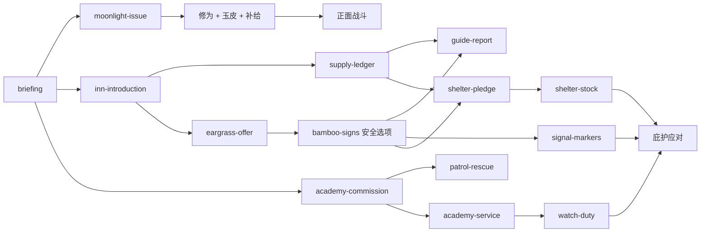

# P1 规则冻结与 P2 交接

2026-10-18。情境 `qingmao-fourteen-day-prototype`；规则 `prototype-rules-1`；内容 `prototype-content-1`；轨迹格式 `1`。最终检查与保留集记录见 `verification.md`。

## 边界与设计假设

原型独立放在 `src/game/prototype/`，不接入默认 Web 开局、浏览器存档或正式165日篇章。此阶段交付规则及证据，Godot 场景、保存恢复、实际导出和真人试玩属于后续阶段。

| 原版缺口 | 原型机制 | 可证伪方式与当前证据 |
| --- | --- | --- |
| 修为不影响狼潮 | 每6修为增加普攻/月刃伤害，每12增加真元容量 | seed42 战备初态只撤去修为优势后死亡；正常合法战备轨迹成功 |
| 持有蛊就算能力 | 只有清醒并装备才提供能力 | 同一危机把地听草置休眠，庇护选项被拒绝且转战失败；玉皮休眠实际多受2伤 |
| 关系只是记录 | 队长委托与掌柜庇护需要具体交付 | 同一情报路线只移除队长关系，庇护被拒绝且转战失败 |
| 睡觉清掉风险 | 关注衰减，物证持久且有来源 | 关注衰减至0后仍保留暴露；花1行动4石才能移除 |
| 囤钱包办结局 | 补给容量/使用次数与具体筹备链 | 开发集劳作带足补给仍失败；最终战搜索排除了单纯战斗政策较弱的解释 |
| 卸装逃供养 | 持有未封存均收费，当日义务独立保留 | 卸装仍付费；当日封存仍结旧账；零钱可劳作恢复 |

反事实用例有意构造单变量边界，不冒充正常游玩取得的路线。两条成功、一条失败的正常路线均由合法公开动作生成。

## 冻结参数

| 系统 | 值 |
| --- | --- |
| 日程 | 14日，每日3行动，共42；查看/普通移动/装备切换免费；办事、修炼、侦察、休整、养护、处理物证耗行动 |
| 初态 | 学堂，生命28，真元12，元石12，药草2，酒0，修为/情报/关系0 |
| 收支 | 安全劳作+2石/行动；三地点中只有学堂、客栈可劳作；每只未封存蛊1石/日 |
| 修炼 | 3真元/行动，+3修为；有效酒虫额外+2；修为上限60；每12修为+2真元上限 |
| 补给 | 药草2石、最多6；酒3石、最多3；药草恢复10生命、酒恢复6真元；每场分别最多用3次，使用也承受当回合敌人攻击 |
| 恢复 | 休整1行动，+8生命/+5真元；普通跨日+4生命、真元补满、关注−1；第14日日暮结算后直接危机，不额外恢复 |
| 侦察 | 3真元/行动；无地听草+1情报/1药草，留下物证；30%遇山狼，其余受2–6伤；有有效地听草+2情报/1药草，无随机伤害/遇敌；情报上限8 |
| 养护 | 封存1行动1石；唤醒封存蛊1行动2石、休眠蛊1行动1石；封存/唤醒不擦除当日供养义务 |
| 物证 | 客栈1行动4石处理；每条暴露使所有山狼战斗每次敌伤+2，庇护准备−1；关注自行衰减不等于消除物证 |
| 普攻/防御 | 普攻伤害3+每6修为1点，回复1真元；防御当回合减伤6、回复3真元 |
| 月光蛊 | 领取需1行动；月刃耗3真元，伤害8+每6修为2点 |
| 玉皮蛊 | 购价8石及1行动；被动减伤2；主动耗2真元、当回合护盾8 |
| 地听肉耳草 | 购价8石及1行动；安全侦察、路线标记、庇护能力、撤退少受4伤；事件另有明确真元成本 |
| 酒虫 | 购价6石及1行动；修炼效率+2，增加日常供养；战备策略完成成长后封存 |
| 落单山狼 | HP18–24，意图伤害5/8/3循环；仅真实巡山救援胜利奖10石/队长+3；随机遭遇不额外奖钱/关系 |
| 撤退 | 受6伤、失至多2石；有效地听草减伤4；无胜利奖励；最终危机撤退为失败 |
| 最终狼群 | HP60–76，意图伤害6/10/4/8循环；击杀后敌人不再出手 |
| 庇护 | 危机前落实路线、契约、备粮、守望班次；危机另付6石；需有效地听草、情报≥5、队长≥3、掌柜≥4；准备=情报+队长关系−暴露，覆盖随机需求8–12则成功；不足先受10伤再战斗，费用不退 |

供养采用全体结算：钱够则付全款并使未封存蛊清醒；不足不部分扣款，全部未封存蛊休眠。不引入永久饿死。义务当日不可通过卸装/封存消除，之后封存日不收费。

成本数值来自内容参数及规则常量；权威数据为 `src/game/prototype/content.ts`，输出为 `shared/prototype/content.json`。改动必须重新评估版本、冻结夹具并检查差异。

## 事件窗口和因果图

| 窗口 | 稳定 ID | 主要结果/依赖 |
| --- | --- | --- |
| 1–3 | briefing | 免费目标与期限；后续入口 |
| 1–3 | moonlight-issue | 已阅读说明后领取月光 |
| 1–4 | inn-introduction | 4石、掌柜+2；客栈后续入口 |
| 2–5 | academy-commission | 4石、队长+1、巡山资格 |
| 2–6 | supply-ledger | 掌柜≥2，6石/掌柜+2 |
| 2–8 | jade-offer | 8石购玉皮 |
| 3–8 | eargrass-offer | 掌柜≥2，8石购地听草 |
| 3–7 | liquor-offer | 6石购酒虫 |
| 3–7 | bamboo-signs | 地听草安全得3情报，或越界得2情报并受伤/暴露 |
| 4–7 | patrol-rescue | 巡山资格→真实战斗→一次胜利奖励 |
| 4–10 | healer-herbs | 1行动换3药草，容量限制有效 |
| 5–9 | academy-service | 队长≥1、交4石→队长+2、补给交付 |
| 6–10 | guide-report | 掌柜≥3、情报≥2→情报+1、掌柜+1 |
| 8–14 | alarm | 免费预警和两套筹备清单 |
| 8–12 | signal-markers | 情报≥2、有效地听草/2真元→路线标记、情报+2 |
| 8–11 | shelter-pledge | 掌柜≥4、情报≥3、8石→庇护约定、掌柜+1 |
| 9–12 | watch-duty | 队长≥3、1药草→守望完成、队长+2、4石 |
| 9–12 | shelter-stock | 已有约定、交2药草→备粮完成、掌柜+1 |
| 14日结后 | crisis-arrival | 先结供养，按已有能力迎战或履约庇护；禁止再筹备 |



箭头只表示必要信息/交付的主要路径，不表示唯一行动顺序。事件窗口包含首尾日期；可暂缓后重开，奖励只在合法选择时发一次；过期记录到 `missedEvents`。内容校验的单调可达性分析不证明经济可达性，正常合法模拟补充实际路径证据。

## 策略与代表轨迹

- 战备：领取月光、有限委托周转、购买玉皮/酒虫、7次修炼到33修为、救援获得一次奖励、封存酒虫、保留月光/玉皮及战前补给；42行动中26次劳作。
- 情报庇护：经营两位对象、购买地听草、封存月光降低后续负担、核对狼迹/口供并设置路线、交付契约/药资/守望；情报8+队长5=13覆盖公开需求上界12；42行动中27次劳作。
- 劳作对照：领取相同月光及预警，余41次行动劳作，末日买满6药草/3酒并尽力战斗；未投入修为、防护、路线和庇护安排。

`shared/fixtures/prototype/` 保存 seed42 的完整合法轨迹：战备90步、情报94步、劳作81步；步数包含免费查看、移动、购买和战斗，不能与42次日程行动混淆。`manifest.json` 提供文件字节 SHA256。

开发集1–100：战备100%生还/平均余32石/修为33；情报100%/余27石/修为0；劳作0%/余63石。不是靠没钱或漏买补给使对照失败。额外审计以同样合法劳作准备进入最终战，搜索全部战斗操作并合并同板面，覆盖17种敌HP，均无生还路径；不外推为全筹备策略空间的最优证明。

完整检查/冻结后首次评估保留集10001–10100，三策略分别100%/100%/0%，平均余石/修为也一致；未据此调参。两集失败种子及汇总见 `balance-summary.json`，实际命令与冻结哈希见 `verification.md`。

## P2 必须遵守的交接

1. 在精确引擎版本锁定后创建并行 `godot/` 工程。当前未安装/运行 Godot；不能声称桌面或 Web 已通过。
2. 从冻结共享数据生成/复制到 Godot 资源根内，禁止依赖导出不存在的 `res://../shared`；禁止手改两份内容。
3. 先迁移纯 RNG 及黄金向量，再迁移 State/Action/Rules/Queries，逐步比较同版本轨迹和抽样次数。禁止换成 Godot 自带 RNG。
4. Node 回放比较全状态，包括账本/日志；Godot 若需去掉纯表现字段，必须先定义明确投影，不能悄悄忽略规则字段。
5. GameSession/存档仅由规则提交，坏档与旧格式严格拒绝/恢复。原型夹具是开发工具，不是玩家存档或发行调试入口。
6. 100%自动路径成功说明存在稳妥筹备，不等于真人难度合理；P3/P4仍需键鼠实玩、引导理解、节奏与混合策略检查。14日数值不能直接放大到165日。

## 重现命令

```sh
npm run check
npm run prototype:freeze -- --check
npm run content:validate
npm run prototype:replay
npm run prototype:simulate -- --set development --verify --out artifacts/prototype/development
npm run prototype:audit-combat
```

保留集命令和最终执行结果见 `verification.md`。原版 E2E 基线失败见 `baseline.md`；保持失败归属准确。
